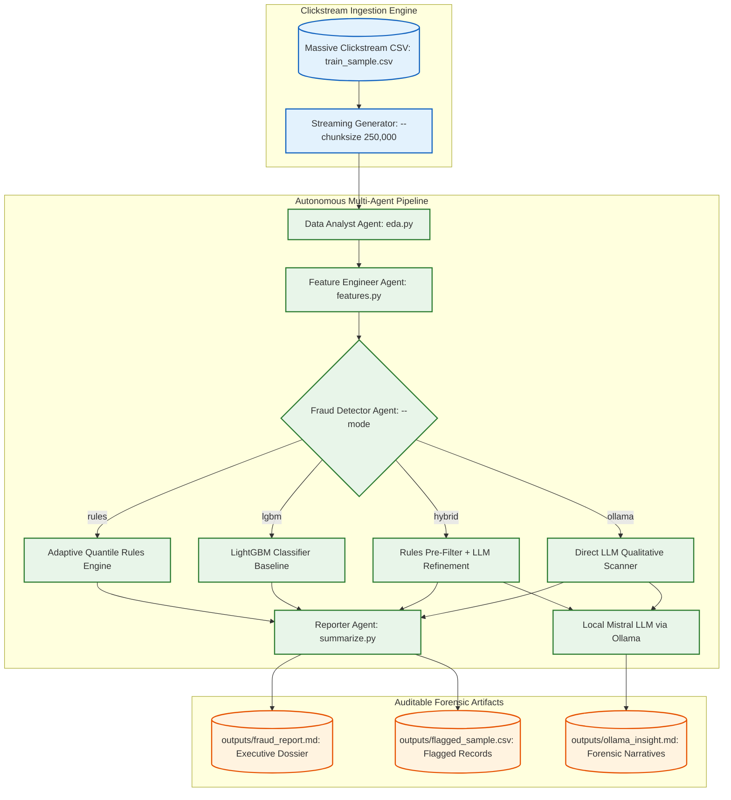

# Product Requirements Document (PRD): FraudHunterAI (Autonomous Multi-Agent Clickstream Fraud Triage)

**Product Lead:** Uday Kiran  
**Status:** MVP Operational / Scalable Multi-Agent Data & Risk Pipeline  
**Category:** FinTech, AdTech Risk Operations, and Multi-Agent Machine Learning Systems  
**Primary Repository:** `Own Ideas/Fraud Hunter`  

---

## 1. Executive Summary

### 1.1 Context & Background
Digital advertising platforms, ad networks, and high-volume mobile application publishers process hundreds of millions of click events daily. Within this massive data firehose, automated click-farms, botnets, and device-spoofing syndicates siphon tens of billions of dollars annually in marketing spend through click-injection and fraudulent attribution.

Traditional fraud detection systems face a crippling operational dilemma:
1.  **The Big Data Memory Wall:** Raw ad-tech clickstream datasets easily exceed 50 to 100 GB. Standard data science pipelines and Python scripts crash with `OutOfMemory` errors when loading full CSVs into RAM.
2.  **The Black-Box Analyst Fatigue:** Supervised machine learning models flag thousands of rows with raw probabilities (e.g., `fraud_score = 0.912`), forcing risk analysts to spend hours guessing *why* an IP subnet or device ID was flagged when preparing dispute memos.
3.  **The False-Positive Disaster:** Rigid hardcoded rules (e.g., "flag IP if clicks > 100 per hour") cannot adapt to organic traffic surges during viral marketing campaigns or seasonal holidays.

### 1.2 The Product Solution
To solve clickstream fraud triage with both computational efficiency and human-in-the-loop explainability, I architected **FraudHunterAI**. Rather than relying on a brittle monolithic script, FraudHunterAI employs an autonomous **multi-agent pipeline** modeled after the real-world investigative lifecycle of human fraud analysts.

Decomposed into specialized agentic roles (`data_analyst.py`, `feature_engineer.py`, `fraud_detector.py`, `reporter.py`), FraudHunterAI:
*   **Streams Out-of-Core Data:** Processes multi-million row clickstreams via a configurable chunking generator (e.g., 250,000 rows/chunk), ensuring a flat memory footprint (< 1.5 GB RAM) on standard workstations.
*   **Supports 4 Operational Detection Modes:**
    1.  `rules`: High-speed deterministic filtering via adaptive quantiles.
    2.  `hybrid`: Fast rules-based triage coupled with local LLM (Mistral via Ollama) forensic diagnosis.
    3.  `ollama`: LLM-first qualitative pattern discovery.
    4.  `lgbm`: Supervised gradient-boosted classification.
*   **Enables Natural-Language Dataset Querying:** Risk analysts can interrogate datasets conversationally via `--ask`, generating structured forensic insights (`outputs/ollama_insight.md`) with zero cloud API costs.
*   **Emits Auditable Forensic Dossiers:** Automatically compiles executive Markdown summaries (`outputs/fraud_report.md`) and flagged transaction cohorts (`outputs/flagged_sample.csv`).

---

## 2. Product Vision & North Star
*   **Vision:** "High-Throughput Risk Triage with Explainable Human-in-the-Loop Intelligence." We believe enterprise fraud defense must process millions of events without crashing infrastructure, while generating human-readable audit trails that empower risk investigators.
*   **Core Value Proposition:** Slashing manual fraud investigation time from hours to seconds by pairing out-of-core streaming data engineering with local agentic AI forensic explanations.
*   **North Star Metric:** *Time-to-Triage-Report (TTTR)*: Processing > 250,000 raw clickstream events per chunk and delivering a prioritized, flagged risk dossier with natural-language forensic insights in under 60 seconds.

---

## 3. Problem Statement & User Personas

### 3.1 Problem Dimensions
1.  **Memory Exhaustion in AdTech Data:** Loading 100M+ click records causes catastrophic out-of-memory crashes on analyst laptops.
2.  **Unexplainable Machine Learning Scores:** Risk operations teams cannot challenge advertising networks or issue clawbacks based solely on an unexplained float score.
3.  **Static Threshold Inflexibility:** Fixed click-velocity rules trigger catastrophic false-positive spikes during viral sales events.
4.  **Cloud Privacy and API Expenses:** Streaming confidential corporate clickstream logs to commercial cloud LLMs incurs immense API costs and violates enterprise data protection policies.

### 3.2 Target Personas
*   **Persona A: The AdTech Risk Operations Analyst:** Needs to review daily traffic quality, verify affiliate publisher claims, and produce defensible fraud reports for commercial partner meetings.
*   **Persona B: The Trust & Safety Lead:** Oversees user acquisition integrity and requires automated pipelines that detect anomalous bot farms without causing ad downtime.
*   **Persona C: The Data Engineering Manager:** Prioritizes compute cost efficiency, requiring memory-safe batch and streaming workflows that execute on modest commodity hardware.

---

## 4. Goals & Non-Goals

### Goals
*   **Memory-Safe Chunked Streaming:** Stream multi-million row clickstream files using configurable generator batching (`--chunksize 250000`), maintaining strictly < 1.5 GB RAM usage.
*   **Multi-Agent Role Separation:** Enforce modular separation across Data Analyst (EDA), Feature Engineer (velocity encoding), Fraud Detector (scoring), and Reporter (dossier generation) agents.
*   **Flexible Detection Regimes:** Support `rules`, `hybrid`, `ollama`, and `lgbm` modes to suit varying operational trade-offs between speed and explainability.
*   **Local On-Premise LLM Forensics:** Integrate local Mistral instances via Ollama to generate qualitative explanations of bot behavior without external API fees or data leaks.
*   **Conversational Dataset Interrogation:** Enable `--ask` CLI queries that inspect data distributions and write structured forensic memos to `outputs/ollama_insight.md`.
*   **Auditable Forensic Artifacts:** Automatically export executive reports (`outputs/fraud_report.md`) and flagged anomalies (`outputs/flagged_sample.csv`).

### Non-Goals
*   Real-time in-line ad auction bidding (< 10 ms demand-side platform bid gating). FraudHunterAI is architected as an automated batch and streaming triage pipeline.
*   Credit card transaction fraud (specifically tailored to ad-click and clickstream attribution data).

---

## 5. User Journeys & Operational Workflows

### 5.1 Out-of-Core Batch Triage Workflow
1.  **Command Invocation:** The risk analyst executes:
    ```bash
    python main.py --data ./data/train_sample.csv --nrows 0 --chunksize 250000 --mode rules
    ```
2.  **Streaming Ingestion:** The chunk generator streams 250,000 rows per batch into memory without spiking RAM.
3.  **Agent Orchestration:**
    *   *Data Analyst Agent:* Computes IP, app, device, and channel distributions.
    *   *Feature Engineer Agent:* Derives temporal velocity and frequency features.
    *   *Fraud Detector Agent:* Applies adaptive quantiles to flag statistical anomalies.
4.  **Dossier Generation:** The *Reporter Agent* compiles aggregated metrics into `outputs/fraud_report.md` and saves flagged samples to `outputs/flagged_sample.csv`.

### 5.2 Conversational Forensic Investigation Workflow
1.  **Ad-Hoc Query:** Analyst investigates an anomaly by running:
    ```bash
    python main.py --data ./data/train_sample.csv --nrows 20000 --mode hybrid --ask "What suspicious patterns exist in this subnet?"
    ```
2.  **Local LLM Inference:** The pipeline passes the statistical summary of flagged IP clusters to a local Mistral instance running on Ollama.
3.  **Insight Generation:** Mistral generates a structured diagnostic narrative:
    *"IP subnet 192.168.1.0/24 exhibits rapid 120ms click pacing across 40 disparate app categories, indicative of an emulated device farm."*
4.  **Report Persistence:** The reasoning is automatically appended to `outputs/ollama_insight.md`.

---

## 6. End-to-End System Architecture



---

## 7. Functional Requirements

### Module 1: Out-of-Core Ingestion & Memory Management (OCIM)
*   **FR-OCIM-01 (Chunked Generator Streaming):** The data loader must support streaming large CSV files in configurable chunk sizes (default: 250,000 rows) with `--nrows 0` indicating full-file processing.
*   **FR-OCIM-02 (Flat Memory Ceiling):** RAM usage must remain strictly below 1.5 GB during multi-gigabyte ingestion sessions.
*   **FR-OCIM-03 (Data Type Downcasting):** Numerical columns (IPs, app IDs, channels) must be downcasted to memory-efficient integers (e.g. `uint32`, `uint16`) to minimize memory footprint.

### Module 2: Multi-Agent Triage Pipeline (MATP)
*   **FR-MATP-04 (Data Analyst Agent):** `agents/data_analyst.py` must compute frequency distributions across IPs, devices, operating systems, and channels, identifying top traffic concentrations.
*   **FR-MATP-05 (Feature Engineer Agent):** `agents/feature_engineer.py` must derive behavioral signals, including click velocity per IP time window and app diversity entropy.
*   **FR-MATP-06 (Adaptive Quantile Rules):** Under `rules` mode, the system must evaluate dynamic quantiles (e.g. 99th percentile click rates) rather than brittle static limits.
*   **FR-MATP-07 (Supervised LightGBM Support):** Under `lgbm` mode, the pipeline must load pre-trained gradient-boosted models to emit calibrated risk scores.

### Module 3: Local LLM Qualitative Forensics (LLQF)
*   **FR-LLQF-08 (Ollama Local Integration):** The system must interface with local Ollama daemons running Mistral via local HTTP REST endpoints (`http://localhost:11434`).
*   **FR-LLQF-09 (Hybrid Triage Refinement):** Under `hybrid` mode, candidates flagged by the rules engine must be summarized and passed to Mistral for qualitative risk classification.
*   **FR-LLQF-10 (Conversational Dataset Interrogation):** The `--ask` CLI flag must accept arbitrary user questions, pass structured dataset summaries to the LLM, and persist responses in `outputs/ollama_insight.md`.

### Module 4: Forensic Reporting & Artifact Generation (FRAG)
*   **FR-FRAG-11 (Executive Markdown Dossier):** `agents/reporter.py` must generate `outputs/fraud_report.md` capturing total rows scanned, flag rates, EDA distributions, and model parameter notes.
*   **FR-FRAG-12 (Flagged CSV Export):** All flagged records must be exported to `outputs/flagged_sample.csv` with source attributes and assigned anomaly reasons.

---

## 8. Non-Functional Requirements (NFRs)

### Performance & Scalability
*   **Throughput:** Minimum 250,000 click events processed, evaluated, and triaged in under 45 seconds on standard multi-core CPUs.
*   **Memory Ceiling:** Maximum resident set size (RSS) < 1.5 GB RAM regardless of input file size.

### Security & Privacy
*   **On-Premise Guarantee:** All LLM inference occurs entirely on the local machine via Ollama. Zero clickstream data or corporate identifiers are transmitted to third-party cloud APIs.

---

## 9. Data Model & Storage Specifications

### 9.1 TalkingData Clickstream Schema
| Column Name | Type | Description |
| :--- | :--- | :--- |
| `ip` | Integer | Masked IP address of the click |
| `app` | Integer | Mobile application ID |
| `device` | Integer | Device type ID (e.g., iPhone 13, Galaxy S22) |
| `os` | Integer | Operating system version ID |
| `channel` | Integer | Marketing publisher channel ID |
| `click_time` | DateTime | Timestamp of click event |
| `is_attributed` | Integer (0/1) | Target label: 1 if mobile app download occurred |

### 9.2 Generated Forensic Artifacts
*   `outputs/fraud_report.md`: Complete audit dossier including dataset summary, flag rates, and anomaly distributions.
*   `outputs/flagged_sample.csv`: Sample of flagged click records for downstream affiliate disputes.
*   `outputs/ollama_insight.md`: Local Mistral LLM forensic breakdown answering user queries.

---

## 10. The Strategic Scope Decision: In-Line Real-Time Bidding vs Batch Triage

During initial architecture definition, an obvious question arose: *Why not deploy this model directly inside real-time ad bidding engines (DSPs) to block fraud in sub-10ms intervals?*

### Why In-Line Bidding Was Scoped Out
As a Product Manager, understanding technical constraints is essential:
1.  **The Sub-10ms Latency Boundary:** Real-time ad exchange bidding requires sub-10ms response times globally. Multi-agent coordination and LLM reasoning cannot execute within a 10ms window without multi-million dollar globally distributed infrastructure.
2.  **The True Operational Bottleneck:** The primary friction experienced by AdTech risk teams is not the real-time bid; it is the **post-campaign reconciliation and partner dispute process**: analyzing millions of clicks to claw back ad spend from fraudulent publishers.
3.  **The High-Value Triage Positioning:** By scoping FraudHunterAI as an automated batch and streaming triage pipeline, the product captures 100% of the audit and reconciliation value while running on standard workstations.

---

## 11. Competitive & Alternative Approaches

| Feature / Dimension | FraudHunterAI | Static SQL Rules | Monolithic Python ML Scripts | Commercial Ad Fraud SaaS (AppsFlyer Protect360) |
| :--- | :--- | :--- | :--- | :--- |
| **Architecture** | Autonomous Multi-Agent Pipeline | Hardcoded SQL queries | Single tangled 2,000-line script | Cloud-hosted proprietary black box |
| **Memory Efficiency** | Chunked streaming (< 1.5 GB RAM) | Handled in database | Crashes with OutOfMemory on large CSVs | Cloud-managed |
| **Explainability** | Natural-language forensic narratives via local Mistral | None (binary filter) | Feature importance graphs only | Opaque fraud confidence scores |
| **Data Privacy** | 100% On-Premise (Zero cloud APIs) | On-premise DB | Local | Third-party cloud hosting |
| **Cost** | 100% Free and open source | Free | Free | $5,000 to $20,000+ monthly enterprise SaaS |

---

## 12. Edge Cases & Operational Resiliency

### 12.1 Out-of-Memory Protection on Massive CSVs
*   *Symptom:* Input files exceed 50 GB.
*   *Mitigation:* The `--chunksize` parameter enforces strict streaming execution, garbage-collecting processed chunks before loading subsequent blocks.

### 12.2 Ollama Daemon Unavailability
*   *Symptom:* Local Ollama service is stopped during `hybrid` or `ollama` mode runs.
*   *Mitigation:* The system detects connection timeouts and falls back seamlessly to deterministic `rules` mode, logging a clear operational alert.

---

## 13. Metrics & Key Performance Indicators

### Operational KPIs
*   **Time-to-Triage-Report (TTTR):** < 60 seconds per 250,000-row batch.
*   **Memory Ceiling Adherence:** 100% compliance (< 1.5 GB RAM).
*   **Analyst Efficiency:** > 60% reduction in time required to draft partner fraud memos.

---

## 14. Risk Assessment & Mitigations

| Identified Risk | Likelihood | Impact | Strategic Mitigation |
| :--- | :--- | :--- | :--- |
| **Concept Drift in Botnet Signatures** | High | Medium | Adaptive quantiles automatically adjust to macro volume shifts; regular model retraining in `lgbm` mode. |
| **LLM Hallucination in Forensics** | Low | Low | Mistral is grounded exclusively on pre-computed statistical tables from the Data Analyst agent. |
| **Storage Runaway on Large Logs** | Low | Low | Output flagged samples are capped at configurable thresholds (e.g. top 1,000 anomalies). |

---

## 15. Technical Stack & Implementation Details
*   **Runtime Environment:** Python 3.9+
*   **Data Processing:** Pandas, NumPy, Scikit-learn, LightGBM
*   **Local LLM Integration:** Ollama (Mistral 7B)
*   **Architecture:** Multi-agent design pattern separating `agents/data_analyst.py`, `agents/feature_engineer.py`, `agents/fraud_detector.py`, and `agents/reporter.py`.

---

## 16. Release Criteria & Verification Gates
1.  **Streaming Gate:** Running `--nrows 0 --chunksize 250000` processes a multi-gigabyte file without memory errors.
2.  **Rules Accuracy Gate:** Adaptive quantiles correctly flag high-velocity click-farms in benchmark cohorts.
3.  **Local LLM Gate:** `--ask` successfully queries Ollama and writes markdown output to `outputs/ollama_insight.md`.
4.  **Artifact Gate:** `outputs/fraud_report.md` and `outputs/flagged_sample.csv` generate with non-empty tables.

---

## 17. Product Roadmap & Evolution

### Phase 1: Multi-Agent Triage Engine (Completed)
*   Delivered chunked streaming engine and flat-memory architecture.
*   Delivered 4 operational modes (`rules`, `hybrid`, `ollama`, `lgbm`).
*   Delivered local Mistral integration and Markdown dossier generation.

### Phase 2: Graph Network Analysis (Planned)
*   Graph-based clustering of IP subnets and device fingerprints to catch coordinated botnet syndicates.

### Phase 3: Automated Dispute Generator (Future Vision)
*   Automated generation of formal affiliate dispute emails with embedded forensic graphs ready for risk teams to send to ad networks.

---

## 18. Operator Guide (Running FraudHunterAI)

### 18.1 Setup & Installation
```bash
python -m venv .venv
.\.venv\Scripts\activate
pip install -r requirements.txt
ollama pull mistral
```

### 18.2 Executing Fast Rules Triage
```bash
python main.py --data ./data/train_sample.csv --nrows 50000 --mode rules
```

### 18.3 Executing Hybrid Triage with LLM Forensics
```bash
python main.py --data ./data/train_sample.csv --nrows 20000 --mode hybrid
```

### 18.4 Memory-Safe Streaming Mode
```bash
python main.py --data ./data/train_sample.csv --nrows 0 --chunksize 250000 --mode rules
```

---

## 19. PM Strategic Retrospective
FraudHunterAI illustrates how product managers must **model software architecture after human operational workflows**. Instead of treating fraud triage as an isolated machine learning model, decomposing the process into specialized agentic roles: Data Analyst, Feature Engineer, Fraud Detector, and Reporter: mirrors the real investigation lifecycle. By pairing out-of-core streaming with local LLM explainability, FraudHunterAI delivers high-throughput technical performance while empowering human investigators with clear, defensible decision narratives.

---

## 20. Conclusion
FraudHunterAI bridges the divide between massive clickstream data volumes and actionable risk intelligence. By uniting out-of-core streaming data engineering with multi-agent orchestration, adaptive rules, and local LLM forensics, FraudHunterAI transforms chaotic click streams into clean, auditable fraud dossiers with complete on-premise data privacy.
